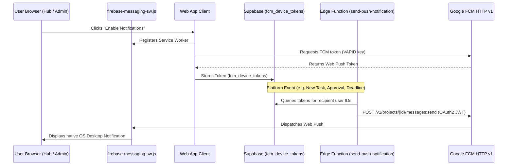

# Firebase Cloud Messaging (FCM) Web Push Notification Setup

This guide details the complete configuration required to deliver web and mobile push notifications for Bauhaven Hub and Bauhaven Admin using Firebase Cloud Messaging (FCM HTTP v1 API).

---

## 1. Firebase Project Setup

1. Open the [Firebase Console](https://console.firebase.google.com/) and create a new project (e.g. `bauhaven-production`).
2. Add a **Web App** (`</>` icon):
   - Name: `Bauhaven Hub & Admin`
   - Check or leave Firebase Hosting unchecked (Hostinger is used).
   - Register the app and copy your Firebase SDK config values.
3. Generate **Web Push Certificates (VAPID Key)**:
   - Go to **Project Settings** &rarr; **Cloud Messaging** tab.
   - Under **Web configuration** &rarr; **Web Push certificates**, click **Generate key pair**.
   - Copy the generated key pair string (this is your `NEXT_PUBLIC_FIREBASE_VAPID_KEY`).

---

## 2. Web Application Environment Variables

Add the following keys to your `.env.local` in `Bauhaven-Academy-Web` and `Bauhaven-Admin-Web` (and your Hostinger environment settings):

```env
NEXT_PUBLIC_FIREBASE_API_KEY=AIzaSy...
NEXT_PUBLIC_FIREBASE_AUTH_DOMAIN=bauhaven-project.firebaseapp.com
NEXT_PUBLIC_FIREBASE_PROJECT_ID=bauhaven-project
NEXT_PUBLIC_FIREBASE_STORAGE_BUCKET=bauhaven-project.appspot.com
NEXT_PUBLIC_FIREBASE_MESSAGING_SENDER_ID=123456789012
NEXT_PUBLIC_FIREBASE_APP_ID=1:123456789012:web:abcdef123456
NEXT_PUBLIC_FIREBASE_VAPID_KEY=BNxxxxxxxxxxxxxxxxxxxxxxxxxxxxxxxxxxxxxxxxxxxxxxxxxxxxxxxxxxxxxxx
```

---

## 3. Backend Database Setup (Supabase)

Run the SQL migration script located at [`Bauhaven-Platform/supabase/migrations/0040_fcm_device_tokens.sql`](../supabase/migrations/0040_fcm_device_tokens.sql) in your **Supabase Dashboard &rarr; SQL Editor**.

This creates:
- `fcm_device_tokens` table for tracking active user browser/device push tokens.
- Secure Row Level Security (RLS) policies allowing users to manage their own tokens.
- `public.register_fcm_token` helper RPC.

---

## 4. Backend Push Dispatcher (Supabase Edge Function)

1. Obtain your **Firebase Admin Service Account Key**:
   - In Firebase Console, go to **Project Settings** &rarr; **Service accounts**.
   - Ensure **Firebase Admin SDK** is selected.
   - Click **Generate new private key** and download the JSON file.
2. Configure the secret in Supabase:
   - Option A: In the Supabase Dashboard under **Project Settings &rarr; Edge Functions &rarr; Secrets**:
     - `FIREBASE_PROJECT_ID`: Your Firebase project ID
     - `FIREBASE_CLIENT_EMAIL`: The `client_email` from the downloaded JSON
     - `FIREBASE_PRIVATE_KEY`: The `private_key` from the downloaded JSON
   - Option B: Full JSON secret via Supabase CLI:
     ```bash
     supabase secrets set FIREBASE_SERVICE_ACCOUNT='<paste entire JSON content>'
     ```
3. Deploy the Edge Function:
   ```bash
   supabase functions deploy send-push-notification
   ```

---

## 5. How It Works



